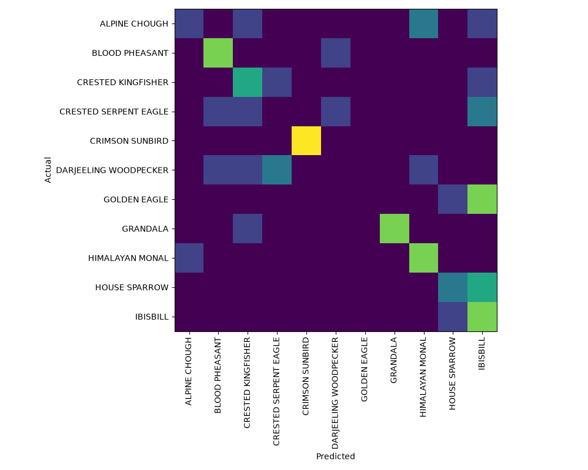
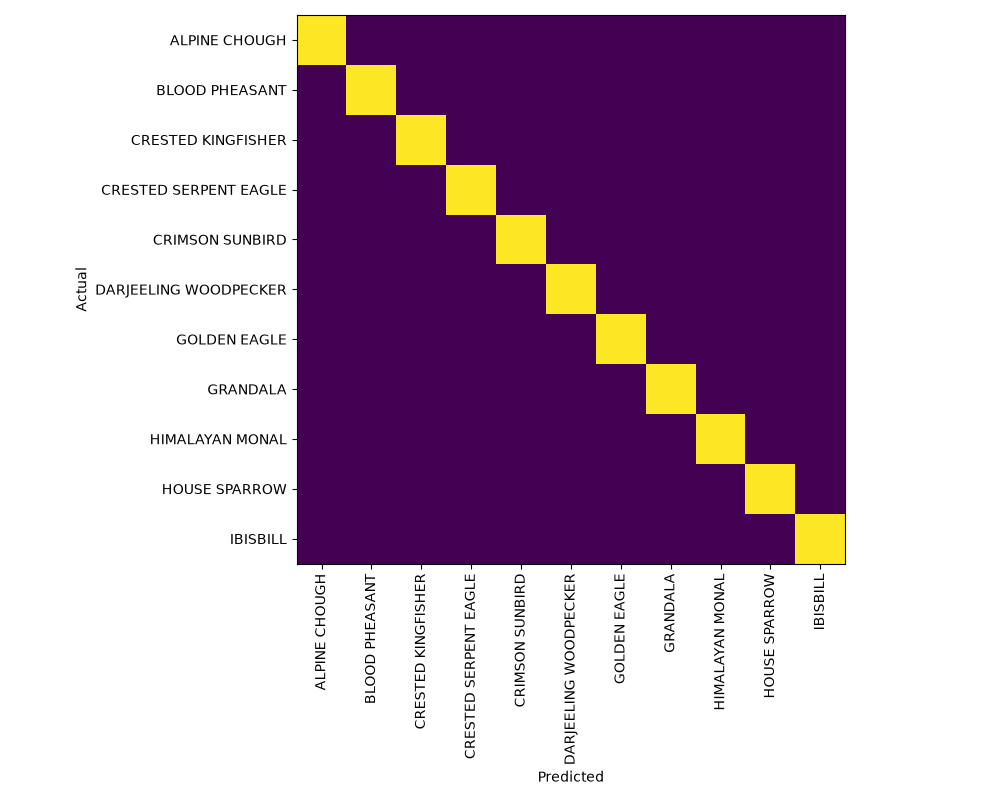
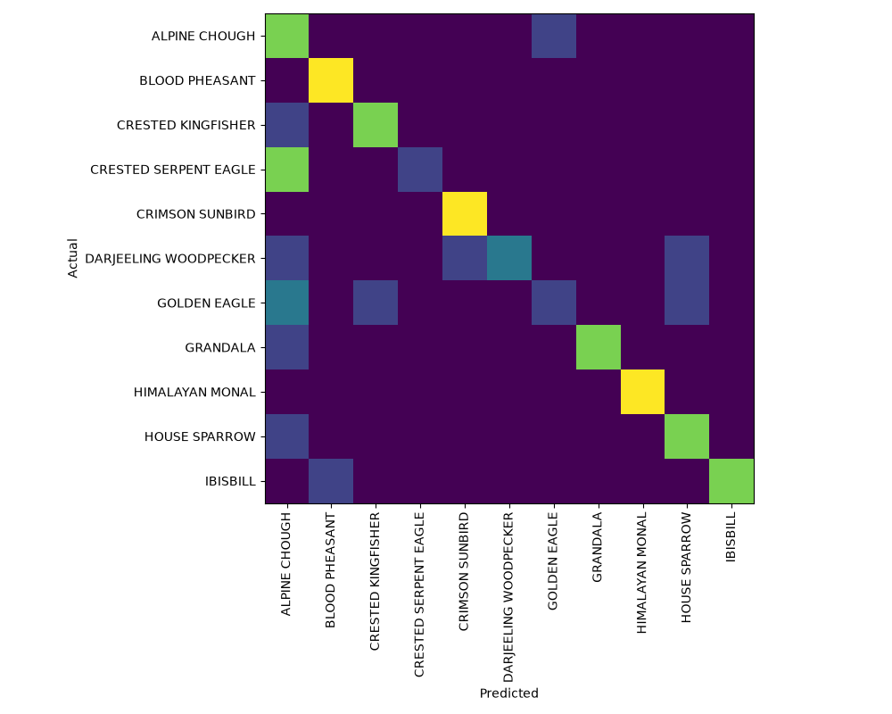

# Bhutan Bird AI

MLA306 — Improving Deep Neural Networks | CA4 final project | Gedu College of Business Studies

A proof-of-concept image classifier for 11 bird species relevant to Bhutan, intended to assist birdwatching, citizen science and conservation. It is not a comprehensive bird identification system.

## Features

- Streamlit image upload (JPEG/PNG), RGB conversion and resizing to 224 × 224.
- EfficientNetB0 inference, predicted species, softmax confidence and top three predictions.
- Grad-CAM visualization (with error handling), low-confidence warning below 60%, and processing time.
- Baseline CNN, transfer learning, Optuna tuning, MixUp/CutMix and stratified cross-validation.

## Quick start (Windows PowerShell)

Extract the project or clone the repository, open its root in VS Code and run:

```powershell
py -3.11 -m venv .venv
.\.venv\Scripts\Activate.ps1
python -m pip install -r requirements.txt
python -m streamlit run app.py
```

Open the local URL printed by Streamlit. The included `models/efficientnet.keras` and `dataset/classes.json` are sufficient for inference; no dataset download or retraining is required. TensorFlow 2.21 is specified in requirements. Other dependency versions are not pinned. The class mapping was reconstructed from the saved classification report and the sorted-label logic in prepare.py; verify against the original training mapping if available.

## Dataset and preprocessing

The original proposal specified Gerald Piosenka's BIRDS 400 dataset. The implementation used the updated 525-species [Hugging Face mirror](https://huggingface.co/datasets/chriamue/bird-species-dataset). The [Avibase Bhutan checklist](https://avibase.bsc-eoc.org/checklist.jsp?lang=EN&list=clements&region=bt) guided the selection. The included species.csv reconstructs the selected folders from the report; its links point to the general checklist, not independently verified species-specific records.

| Split | Per class | Total |
|---|---:|---:|
| Train | 100 | 1,100 |
| Validation | 5 | 55 |
| Test | 5 | 55 |
| Total | 110 | 1,210 |

Classes in output-index order (0–10): Alpine Chough, Blood Pheasant, Crested Kingfisher, Crested Serpent Eagle, Crimson Sunbird, Darjeeling Woodpecker, Golden Eagle, Grandala, Himalayan Monal, House Sparrow, Ibisbill.

Preparation verifies image integrity, hashes decoded RGB pixels to skip exact duplicates across splits (test first), and creates a manifest and sorted class mapping. Near duplicates are not detected. The training loader resizes images, one-hot encodes labels, batches at 16 and prefetches. Baseline rescales pixels by 1/255; EfficientNet includes its own preprocessing. Training augmentation uses horizontal flip, rotation and contrast for EfficientNet; advanced augmentation is enabled for the tuned model. Balanced class weights are computed for training.

## Architecture and optimization

| Model | Architecture |
|---|---|
| Baseline | Conv2D 16/32/64 with ReLU and max pooling, global average pooling, Dense 128 ReLU, 11-way softmax |
| EfficientNet | ImageNet-pretrained frozen EfficientNetB0 (internal Swish), global average pooling, Dense 128 ReLU, dropout 0.2, 11-way softmax |
| Tuned | EfficientNet backbone with Optuna-selected classification head and training settings |

All use categorical cross-entropy. Standard models use Adam at 0.001. Early stopping restores best weights. Optuna searches learning rate, dropout, head width, Adam/AdamW and number of unfrozen layers; this is limited architecture search, not full NAS. Batch size is fixed. MixUp blends images and labels; CutMix replaces a region and mixes labels proportionally. The best of two trials selected learning rate 0.0000561152, dropout 0.480286, width 64, Adam, zero unfrozen layers, with 69.09% validation accuracy. Final models trained for three epochs. ImageNet weights were used rather than bird-specific pretraining.

## Experimental results

Measured on the same 55 held-out dataset images (five per species):

| Model | Accuracy | Macro precision | Macro recall | Macro F1 | Weighted F1 |
|---|---:|---:|---:|---:|---:|
| Baseline | 49.09% | 44.85% | 49.09% | 44.66% | 44.66% |
| EfficientNet | 100% | 100% | 100% | 100% | 100% |
| Tuned | 70.91% | 81.08% | 70.91% | 70.32% | 70.32% |

Standard EfficientNet was selected for deployment. The tuned model improved over baseline but did not beat standard EfficientNet. Low learning rate, high dropout, short training and mixed images are possible explanations, not isolated causal findings. Selection using these test results makes the comparison exploratory; a new independent test set is needed for an unbiased final estimate.

### Confusion matrices





### Five-fold cross-validation

The separate cross_validation.py trains fresh standard EfficientNet models for three epochs each on four folds (924 images), evaluating on the fifth (231). The 55 test images are excluded. Fold accuracies: 100%, 98.70%, 99.13%, 98.70%, 98.27%. Mean: **98.96%**; population standard deviation: **0.59 percentage points**. This is internal validation, not independent field validation.

See [comparison.csv](results/comparison.csv), [CV results](results/cv.csv), [Optuna trials](results/optuna.csv) and the per-model reports and histories in results/.

## Reproduce training (optional)

Download the original split archives using `python download.py` or manually obtain and extract them into `dataset/original/train`, `dataset/original/valid`, `dataset/original/test`, each containing exact species folder names. Check archive layout and dataset license. The download URLs have not been independently retested. Verify the checklist evidence and run:

```powershell
python prepare.py --source dataset/original --limit 100
python train.py --epochs 3 --trials 2 --advanced-augmentation
python cross_validation.py
```

If your split folders are directly under dataset, use `--source dataset` instead. Training requires internet access for pretrained weights unless cached. These commands overwrite existing results and models; back them up first. The original manifest and raw images are not distributed, so exact reproduction is not guaranteed. The optional `train.py --cv` evaluates the tuned configuration, not the standard configuration reported above.

## Repository layout

```text
app.py                 Streamlit inference and Grad-CAM
config.py              Paths, input size, seed and batch size
download.py            Dataset archive download
prepare.py             Image verification, deduplication and manifest
train.py               Model training, tuning and evaluation
cross_validation.py    Standard EfficientNet five-fold evaluation
requirements.txt       Python dependencies
dataset/classes.json   Output label mapping
dataset/species.csv     Selected species and checklist links
models/                Three trained Keras models
results/               Metrics, histories, confusion matrices and CV
```

## Limitations and responsible use

Only 11 known species are supported. Unknown birds can receive a confident incorrect label; the 60% warning is not validated unknown-species detection. The test set is small and curated, and the global dataset is not a Bhutan-specific field collection. Lighting, backgrounds, camera angles and near duplicates may affect generalization. Grad-CAM highlights regions associated with a prediction but does not prove correctness. Future work: independent Bhutan field data, expanded species coverage, calibrated uncertainty, unknown-species detection and more systematic tuning. Verify dataset and pretrained-weight terms before redistribution; no raw images are included. Use predictions as assistance, not a substitute for expert judgment.

## References

- [Bird species dataset mirror](https://huggingface.co/datasets/chriamue/bird-species-dataset)
- [Avibase Bhutan checklist](https://avibase.bsc-eoc.org/checklist.jsp?lang=EN&list=clements&region=bt)
- [EfficientNet (Tan and Le, 2019)](https://arxiv.org/abs/1905.11946)
- [Grad-CAM (Selvaraju et al.)](https://arxiv.org/abs/1610.02391)
- [Optuna](https://optuna.org/), [TensorFlow](https://www.tensorflow.org/), [Streamlit](https://streamlit.io/)